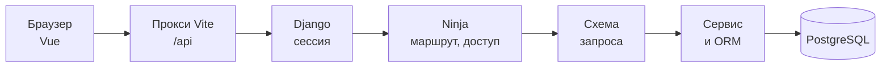
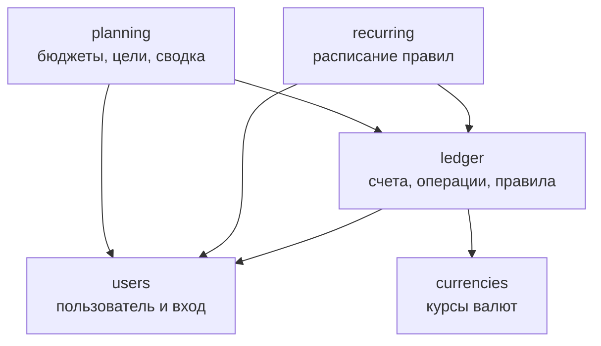
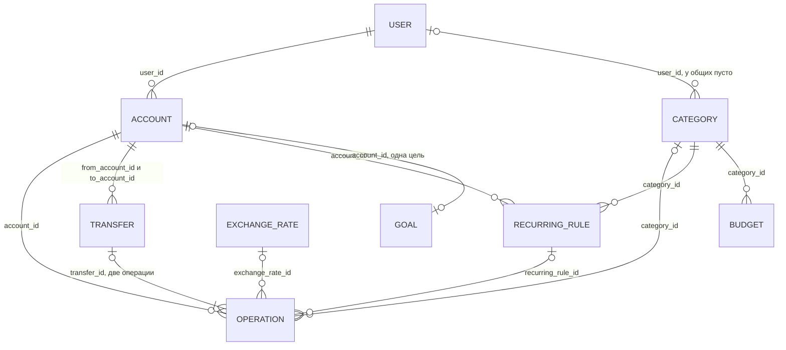

# Архитектура финансового планера

Документ описывает устройство сервиса: сервисы и путь запроса, структуру приложения, модель данных, безопасность, тестирование и принятые компромиссы. Контракт API вынесен в [api.md](api.md). На 27 ноября 2026 г. готовы рабочее окружение (сервисы `db`, `api` и `web`, маршрут `GET /api/health` и стартовая страница проверки), регистрация и вход, таблицы счетов, категорий, операций и переводов с ограничениями и общими категориями, маршруты счетов, категорий, доходов и расходов, а также страницы входа, регистрации, счетов и операций. Всё остальное описано как проект и привязано к шагам реализации из раздела 8.

## 1. Назначение и границы

Планер ведёт учёт личных финансов: счета с начальными остатками, доходы, расходы и переводы между своими счетами, месячные бюджеты по категориям, цели накопления и сводную панель. Каждый пользователь видит только свои данные. К банкам сервис не подключается, операции вносит сам пользователь. Сверх обязательной части выбраны два углубления: периодические операции с защитой от повторного начисления и счета в разных валютах с фиксацией курса Банка России и даты пересчёта. Не входят импорт выписок, прогноз остатка, поиск необычных трат, общий бюджет на нескольких человек, биржевые курсы и мобильное приложение.

## 2. Сервисы и путь запроса

### 2.1. Сервисы

| Сервис | Что делает | Образ и доступ | Состояние |
| --- | --- | --- | --- |
| `web` | Интерфейс на Vue 3, dev-сервер Vite, прокси `/api` на сервис `api` | `node:24-alpine`, порт 127.0.0.1:5173 | Готов |
| `api` | Django и Django Ninja: REST API, админка, миграции при старте | `python:3.14-slim`, порт 127.0.0.1:8000 | Готов |
| `db` | PostgreSQL 18, данные в томе `postgres_data` | `postgres:18-alpine`, порт наружу не открыт | Готов |
| `scheduler` | Раз в час применяет периодические правила, раз в сутки загружает курсы валют. Стартует после сервиса `api`, который применяет миграции | Образ сервиса `api`, команда `run_scheduler`, портов нет | Шаг 19 |
| `caddy` | Отдаёт собранный интерфейс, проксирует `/api` и `/admin` на Gunicorn | Только production-профиль | Шаг 26, если останется время |

### 2.2. Путь запроса



Ответ возвращается по той же цепочке в обратном порядке. В блоке Ninja две проверки, поэтому в таблице у него две строки.

| Блок | Что проверяется | Ответ при отказе |
| --- | --- | --- |
| Прокси Vite | Запрос `/api/...` уходит на `http://api:8000`, поэтому браузер видит один адрес | Ошибка прокси не в JSON, если сервис `api` недоступен |
| Django | Заголовок `Host`, сессия по куке `sessionid`, пользователь запроса | 400 на чужой `Host`. Путь вне маршрутов получает страницу 404 в HTML |
| Ninja, маршрут | Метод и путь | 405, если у пути нет такого метода |
| Ninja, доступ | Токен CSRF у POST, PATCH и DELETE, затем сессия | 403 без токена, 401 без сессии |
| Схема запроса | Разбор JSON, типы, обязательные поля, диапазоны, лишние поля | 400, если тело не разбирается как JSON, 422 при ошибке ввода |
| Сервис и ORM | Принадлежность объекта пользователю и правила операции | 404 на чужой или несуществующий объект, 409 при конфликте с состоянием, 422 при нарушении правила, 403 при попытке изменить общую категорию |
| PostgreSQL | Ограничения целостности, транзакция | Нарушение уникальности, которое при гонке прошло мимо проверки сервиса, сервис перехватывает и отдаёт тем же 422. Неожиданный сбой даёт 500 без подробностей |
| Ответ | Выходная схема | 200, при создании 201, без тела 204 |

У изменяющего запроса токен CSRF проверяется раньше сессии, поэтому запрос без токена и без сессии получает 403, а не 401. Интерфейс в ответ на 403 с кодом `csrf_failed` получает токен заново и повторяет запрос один раз: если сессии нет, повтор вернёт 401. Форматы ошибок с примерами собраны в [api.md](api.md), раздел 2.

## 3. Структура приложения

### 3.1. Бэкенд

Бэкенд состоит из корневого пакета и пяти приложений Django в папке `api/`.

| Пакет | За что отвечает | Модели | Модули | Зависит от | Шаги |
| --- | --- | --- | --- | --- | --- |
| `finance_planner` | Настройки, корневой роутер, обработчики ошибок, `/api/health`, команды `run_scheduler` и `seed_demo` | Нет | `settings.py`, `urls.py`, `api.py`, `errors.py`, `sessions.py`, `management/commands/`, `tests/` | Все приложения | 6, 19, 27 |
| `users` | Регистрация, вход, профиль, часовой пояс и «сегодня» пользователя | `User` | `models.py`, `admin.py`, `api.py`, `schemas.py`, `services.py`, `migrations/`, `tests/` | Нет | 6 |
| `currencies` | Курсы Банка России: загрузка, хранение, курс на дату | `ExchangeRate` | `models.py`, `admin.py`, `api.py`, `schemas.py`, `services.py`, `cbr_client.py`, команда `load_exchange_rates`, `migrations/`, `tests/` с сохранённым ответом ЦБ | Нет | 22 |
| `ledger` | Счета, категории, операции, переводы, балансы и агрегаты по периодам | `Account`, `Category`, `Operation`, `Transfer`, `RecurringRule` | `models.py`, `admin.py`, `api.py`, `schemas.py`, `services.py`, `migrations/`, `tests/` | `users`, `currencies` | 7, 8, 14, 18, 23 |
| `planning` | Бюджеты, цели и сводная панель | `Budget`, `Goal` | `models.py`, `admin.py`, `api.py`, `schemas.py`, `services.py`, `migrations/`, `tests/` | `ledger`, `users` | 15, 16, 17 |
| `recurring` | Расписание правил: плановые даты, применение правил, маршруты правил | Нет | `api.py`, `schemas.py`, `services.py`, команда `apply_recurring_rules`, `tests/` | `ledger`, `users` | 18 |



Зависимости проверены по всем приложениям, циклов нет.

1. Приложения `users` и `currencies` не зависят ни от кого.
2. В `ledger` есть ссылки на пользователя и на курс валюты. О бюджетах, целях и расписании это приложение не знает.
3. Данные `ledger` читают `planning` и `recurring`, текущую дату пользователя они берут у `users`. Друг о друге они не знают.
4. Корневой пакет `finance_planner` подключает роутеры всех приложений, поэтому на схеме не показан. Его не импортирует никто.

Три решения приняты ради этого порядка. Модель правила `RecurringRule` лежит в `ledger`: операция ссылается на правило, а правило на счёт и категорию, и в разных приложениях эти ссылки дали бы цикл. Сводная панель лежит в `planning`, потому что читает и учёт, и планы. Команда `run_scheduler` вызывает сервисы двух приложений, применение правил и загрузку курсов, и поэтому лежит в корневом пакете.

Код приложения разделён на три слоя, как на лекции 13 ноября 2026 г.

1. Маршрут в `api.py` короткий: он принимает проверенную схему запроса, вызывает функцию сервиса и возвращает выходную схему с кодом ответа. Сам он ничего не считает.
2. Сервис в `services.py` выполняет бизнес-операцию и держит её в одной транзакции. О HTTP он не знает, поэтому одну и ту же функцию вызывают маршрут, команда управления и планировщик. О нарушении правила сервис сообщает исключением своего приложения, в код ответа его переводит обработчик корневого роутера.
3. Модель с менеджером играет роль репозитория: отбор по пользователю (`for_user`), аннотация баланса и агрегаты описаны рядом с таблицей. Отдельного слоя репозиториев нет: Django ORM уже реализует этот шаблон, как Eloquent в Laravel.

Простое чтение и удаление без правил маршрут выполняет через менеджер напрямую, отдельная функция сервиса для них не заводится.

| Laravel на лекции | Планер на Django |
| --- | --- |
| `routes/api.php`, группы маршрутов | `finance_planner/api.py`: объект `NinjaAPI` и роутер каждого приложения |
| Controller | Функция-маршрут в `api.py` приложения |
| Middleware (`auth:sanctum`, `VerifyCsrfToken`) | Middleware Django (сессия, пользователь) и авторизация `django_auth` в Ninja (токен CSRF и сессия) |
| FormRequest с `rules()` | Схема запроса Pydantic в `schemas.py` |
| Resource | Выходная схема в параметре `response` маршрута |
| Model (Eloquent) | Модель Django и её менеджер |
| Service | Функция в `services.py` |
| Консольная команда | Команда управления в `management/commands/` |
| Миграция | Миграция Django |

### 3.2. Интерфейс

Папки `router`, `views` и `stores` названы так же, как в официальном шаблоне create-vue.

| Папка в `web/src/` | Содержимое | Состояние |
| --- | --- | --- |
| `assets/` | Шрифт Inter, палитра и базовые стили | Есть |
| `components/` | Повторно используемые компоненты: карточка, диалог, поле суммы | Есть, пополняется |
| `composables/` | Состояние страниц и запросы TanStack Query по ресурсам | Есть, пополняется |
| `services/` | Клиент API: `fetch` с кукой сессии, чтение куки и заголовок `X-CSRFToken`, единый разбор ошибок, функции по ресурсам | Есть, пополняется |
| `types/` | Типы запросов и ответов API | Есть, пополняется |
| `router/` | Маршруты Vue Router и защита страниц по ответу `GET /api/auth/me` | Есть |
| `views/` | Страницы, по одной на маршрут | Есть, пополняется |
| `stores/` | Хранилище Pinia `session`: текущий пользователь и его часовой пояс | Есть |
| `utils/` | Чистые функции: формат суммы и даты | Есть, пополняется |

Серверные данные хранятся только в кэше TanStack Query с ключами по ресурсам. После изменения запросы ресурса и зависящих от него сводок помечаются устаревшими, в Pinia эти данные не дублируются. Типы в `types/` пишутся вручную по [api.md](api.md).

Библиотеки сверх Vue, TypeScript и Vite подключаются по одной на задачу.

| Библиотека | Зачем нужна | Цена | Шаг |
| --- | --- | --- | --- |
| Vue Router | Маршруты страниц и защита страниц без входа, требование задания | Нет | 9 |
| Pinia | Хранилище текущего пользователя. Названа в концепции проекта и разбиралась на лекции 30 октября 2026 г. | Зависимость ради одного хранилища | 9 |
| TanStack Query | Кэш серверных данных, состояния загрузки и ошибки, обновление после изменений | Зависимость и свои правила ключей запросов | 9 |
| PrimeVue | Готовые доступные компоненты: таблица, диалог, календарь, выбор из списка | Размер сборки растёт, тема переопределяется переменными палитры | 9 |
| Chart.js | Круговая диаграмма структуры трат | Зависимость ради одного графика | 17 |

| Страница | Назначение | Маршруты API | Состояния |
| --- | --- | --- | --- |
| `/login` | Вход | `GET /api/auth/csrf`, `POST /api/auth/login` | Отправка, ошибки под полями, неверный логин или пароль, сбой с повтором |
| `/register` | Регистрация, пояс браузера передаётся сам | `GET /api/auth/csrf`, `POST /api/auth/register` | Отправка, ошибки под полями, сбой с повтором |
| `/` | Сводная панель: баланс, доходы и расходы за период, структура трат, бюджеты, цели | `GET /api/summary`, `GET /api/categories`, `GET /api/accounts` | Загрузка, пусто (счетов ещё нет), ошибка, нет входа |
| `/accounts` | Счета и их балансы, архив | `GET`, `POST /api/accounts`, `PATCH`, `DELETE /api/accounts/{account_id}`, с шага 23 `GET /api/exchange-rates` | Загрузка, пусто, ошибка, отказ в удалении (409), нет входа |
| `/operations` | История с фильтрами, формы операции и перевода, диалог «Категории» | Маршруты `/api/operations`, `/api/transfers`, `/api/categories`, `GET /api/accounts` | Загрузка, пусто, ничего не найдено по фильтру, ошибка, нет входа |
| `/budgets` | Лимиты месяца, потрачено и остаток, диалог «Категории» | Маршруты `/api/budgets` и `/api/categories` | Загрузка, пусто, превышение лимита, ошибка, нет входа |
| `/goals` | Цели и прогресс | Маршруты `/api/goals`, `GET /api/accounts` | Загрузка, пусто, цель достигнута, срок прошёл, ошибка, нет входа |
| `/recurring` | Периодические правила | Маршруты `/api/recurring-rules`, `GET /api/accounts`, `GET /api/categories` | Загрузка, пусто, правило выключено, ошибка, нет входа |
| `/status` | Проверка сервисов, открыта без входа | `GET /api/health` | Проверка, работает, нет связи, неизвестно |

Шапка есть на всех страницах после входа: навигация, имя пользователя, диалог «Профиль» с часовым поясом (`PATCH /api/auth/me`) и выход (`POST /api/auth/logout`).

Общие правила состояний одни для всех страниц.

1. Загрузка. Если ответ не пришёл за 400 мс, появляется индикатор. Кнопка, запустившая действие, недоступна до ответа.
2. Пусто. У каждого списка есть текст о том, почему он пуст, и действие, например «Счетов пока нет. Добавьте первый счёт».
3. Ошибка. Текст простыми словами и кнопка повтора, введённое сохраняется. Ошибки 422 показываются под полями формы, остальные ошибки формы видны в ней над кнопками, пока она открыта. Ошибки действий вне формы, например удаления, уходят в уведомление. Если не обновился уже показанный список, он остаётся на экране с пометкой и кнопкой повтора. Ответ не в JSON показывается как общий сбой.
4. Нет входа. Ответ 401 с кодом `not_authenticated` переводит на `/login`, после входа пользователь возвращается на исходную страницу.
5. Формы. У каждого поля видимая подпись, обязательные поля отмечены, проверка идёт при уходе из поля и при отправке. Дата по умолчанию равна сегодняшнему дню в часовом поясе из профиля.
6. Удаление подтверждается в диалоге: кнопка названа действием, фокус по умолчанию стоит на отмене.
7. Состояние не передаётся одним цветом. Превышение бюджета отмечено цветом, значком и подписью.
8. Суммы вводятся текстом: принимаются точка и запятая, пробелы убираются, на сервер уходит строка вида `"1234.50"`. Выводятся суммы с точкой и двумя знаками, с пробелами между разрядами и знаком валюты после числа, табличными цифрами по правому краю.
9. Всё управление доступно с клавиатуры, фокус виден, анимация отключается при `prefers-reduced-motion`.
10. Вёрстка адаптивная: размеры в rem, одна колонка до ширины `40rem`.

## 4. Модель данных

### 4.1. Схема

Первичный ключ каждой таблицы называется `id`. На линии подписан столбец внешнего ключа в таблице со стороны «многие». Внешний ключ `user_id` есть также у операций, переводов, правил, бюджетов и целей: эти линии не проведены, чтобы не закрывать остальные связи. Все поля перечислены в разделе 4.2.



### 4.2. Таблицы

Первичный ключ каждой таблицы: `id bigint`, значение выдаёт база (`GENERATED BY DEFAULT AS IDENTITY`). Значения по умолчанию задаёт Django при создании объекта, в DDL их нет. Денежные суммы хранятся в `numeric(14,2)`, тип `float` для денег не используется. В таблицах ниже первичный ключ опущен.

**Пользователь, `users_user`** (шаг 6). Своя модель на основе `AbstractUser`.

| Поле | Тип PostgreSQL | NULL | По умолчанию | Ограничение | Смысл |
| --- | --- | --- | --- | --- | --- |
| `username` | `varchar(150)` | Нет | Нет | Уникален | Логин, регистр учитывается |
| `password` | `varchar(128)` | Нет | Нет | Нет | Хэш пароля |
| `time_zone` | `varchar(64)` | Нет | Пояс сервера из `DJANGO_TIME_ZONE` | Имя пояса IANA, проверяют схема запроса и валидатор поля | Часовой пояс пользователя |
| `is_active`, `is_staff`, `is_superuser` | `boolean` | Нет | `true`, `false`, `false` | Нет | Стандартные признаки Django |
| `date_joined`, `last_login` | `timestamptz` | Нет, да | Время создания, пусто | Нет | Стандартные метки Django |

Поля `email`, `first_name` и `last_name` достаются от `AbstractUser` и не используются: почта при регистрации не собирается.

**Счёт, `ledger_account`** (шаг 7).

| Поле | Тип PostgreSQL | NULL | По умолчанию | Ограничение | Смысл |
| --- | --- | --- | --- | --- | --- |
| `user_id` | `bigint` | Нет | Нет | Внешний ключ, CASCADE | Владелец |
| `name` | `varchar(100)` | Нет | Нет | Нет | Название |
| `kind` | `varchar(16)` | Нет | Нет | Одно из `cash`, `card`, `savings` | Тип: наличные, карта, накопительный. После создания не меняется |
| `currency` | `varchar(3)` | Нет | `RUB` | Три заглавные латинские буквы | Код валюты, после создания не меняется |
| `initial_balance` | `numeric(14,2)` | Нет | `0` | Нет | Начальный остаток, может быть отрицательным |
| `is_archived` | `boolean` | Нет | `false` | Нет | Счёт в архиве: скрыт из выбора, новые операции не принимает |
| `created_at` | `timestamptz` | Нет | Время создания | Нет | Когда создан |

**Категория, `ledger_category`** (шаг 7).

| Поле | Тип PostgreSQL | NULL | По умолчанию | Ограничение | Смысл |
| --- | --- | --- | --- | --- | --- |
| `user_id` | `bigint` | Да | Пусто | Внешний ключ, CASCADE | Владелец, у общей категории пусто |
| `name` | `varchar(60)` | Нет | Нет | Уникальна в тройке с `user_id` и `kind`, общие категории между собой тоже | Название |
| `kind` | `varchar(8)` | Нет | Нет | Одно из `income`, `expense` | Вид, после создания не меняется |

Общие категории создаёт миграция данных: доходы «Зарплата», «Подарки», «Прочие доходы» и расходы «Продукты», «Транспорт», «Жильё», «Связь», «Здоровье», «Одежда», «Развлечения», «Образование», «Кафе», «Подписки», «Прочие расходы».

**Операция, `ledger_operation`** (шаг 7, часть полей позже).

| Поле | Тип PostgreSQL | NULL | По умолчанию | Ограничение | Смысл |
| --- | --- | --- | --- | --- | --- |
| `user_id` | `bigint` | Нет | Нет | Внешний ключ, CASCADE | Владелец, совпадает с владельцем счёта |
| `account_id` | `bigint` | Нет | Нет | Внешний ключ, RESTRICT | Счёт |
| `category_id` | `bigint` | Да | Пусто | Внешний ключ, RESTRICT. Задана у дохода и расхода, пуста у операций перевода | Категория |
| `kind` | `varchar(12)` | Нет | Нет | Одно из `income`, `expense`, `transfer_out`, `transfer_in` | Вид: доход, расход, списание перевода, зачисление перевода |
| `amount` | `numeric(14,2)` | Нет | Нет | Больше нуля | Сумма в валюте счёта |
| `date` | `date` | Нет | Нет | Нет | Дата операции |
| `note` | `varchar(255)` | Нет | Пустая строка | Нет | Заметка |
| `transfer_id` | `bigint` | Да | Пусто | Внешний ключ, CASCADE. Задан только у операций перевода, пара «перевод и вид» уникальна | Перевод, к которому относится операция |
| `recurring_rule_id` | `bigint` | Да | Пусто | Внешний ключ, SET_NULL (шаг 18) | Правило, создавшее операцию |
| `planned_date` | `date` | Да | Пусто | Обязательна, если задано правило. Пара «правило и плановая дата» уникальна (шаг 18) | Плановая дата срабатывания |
| `exchange_rate_id` | `bigint` | Да | Пусто | Внешний ключ, RESTRICT (шаг 23) | Зафиксированный курс для операции в валюте |
| `created_at` | `timestamptz` | Нет | Время создания | Нет | Когда создана |

**Перевод, `ledger_transfer`** (шаг 7, маршруты на шаге 14).

| Поле | Тип PostgreSQL | NULL | По умолчанию | Ограничение | Смысл |
| --- | --- | --- | --- | --- | --- |
| `user_id` | `bigint` | Нет | Нет | Внешний ключ, CASCADE | Владелец |
| `from_account_id` | `bigint` | Нет | Нет | Внешний ключ, RESTRICT | Счёт списания |
| `to_account_id` | `bigint` | Нет | Нет | Внешний ключ, RESTRICT. Не совпадает со счётом списания | Счёт зачисления |
| `amount_out` | `numeric(14,2)` | Нет | Нет | Больше нуля | Списано, в валюте счёта списания |
| `amount_in` | `numeric(14,2)` | Нет | Нет | Больше нуля | Зачислено, в валюте счёта зачисления |
| `exchange_difference` | `numeric(14,2)` | Нет | `0` | Нет | Курсовая разница в рублях: больше нуля при потере, меньше нуля при выгоде. Столбец есть с шага 7, заполняется с шага 23 |
| `date` | `date` | Нет | Нет | Нет | Дата перевода |
| `note` | `varchar(255)` | Нет | Пустая строка | Нет | Заметка |
| `created_at` | `timestamptz` | Нет | Время создания | Нет | Когда создан |

**Периодическое правило, `ledger_recurringrule`** (шаг 18). Вид создаваемых операций в правиле не хранится: он равен виду его категории.

| Поле | Тип PostgreSQL | NULL | По умолчанию | Ограничение | Смысл |
| --- | --- | --- | --- | --- | --- |
| `user_id` | `bigint` | Нет | Нет | Внешний ключ, CASCADE | Владелец |
| `name` | `varchar(100)` | Нет | Нет | Нет | Название, попадает в заметку созданной операции |
| `account_id` | `bigint` | Нет | Нет | Внешний ключ, RESTRICT | Счёт |
| `category_id` | `bigint` | Нет | Нет | Внешний ключ, RESTRICT | Категория |
| `amount` | `numeric(14,2)` | Нет | Нет | Больше нуля | Сумма |
| `frequency` | `varchar(8)` | Нет | Нет | Одно из `monthly`, `weekly` | Периодичность, после создания не меняется |
| `day` | `smallint` | Нет | Нет | От 1 до 31 для месяца, от 1 до 7 для недели | День месяца или недели, 1 значит понедельник. После создания не меняется |
| `start_date` | `date` | Нет | Нет | Нет | Начало действия, после создания не меняется |
| `end_date` | `date` | Да | Пусто | Не раньше начала | Последний день действия |
| `is_active` | `boolean` | Нет | `true` | Нет | Правило включено |
| `next_date` | `date` | Нет | Считает сервис | Не раньше начала | Следующая необработанная плановая дата. Двигается только вперёд |
| `created_at` | `timestamptz` | Нет | Время создания | Нет | Когда создано |

**Бюджет, `planning_budget`** (шаг 15).

| Поле | Тип PostgreSQL | NULL | По умолчанию | Ограничение | Смысл |
| --- | --- | --- | --- | --- | --- |
| `user_id` | `bigint` | Нет | Нет | Внешний ключ, CASCADE | Владелец |
| `category_id` | `bigint` | Нет | Нет | Внешний ключ, CASCADE | Категория расходов |
| `month` | `date` | Нет | Нет | Первое число месяца. Тройка «пользователь, месяц, категория» уникальна | Месяц бюджета |
| `limit_amount` | `numeric(14,2)` | Нет | Нет | Больше нуля | Лимит в рублях |

**Цель, `planning_goal`** (шаг 16).

| Поле | Тип PostgreSQL | NULL | По умолчанию | Ограничение | Смысл |
| --- | --- | --- | --- | --- | --- |
| `user_id` | `bigint` | Нет | Нет | Внешний ключ, CASCADE | Владелец |
| `name` | `varchar(100)` | Нет | Нет | Нет | Название |
| `target_amount` | `numeric(14,2)` | Нет | Нет | Больше нуля | Целевая сумма в рублях |
| `deadline` | `date` | Нет | Нет | Нет | Срок |
| `account_id` | `bigint` | Да | Пусто | Внешний ключ, RESTRICT. К счёту привязана не больше чем одна цель | Рублёвый накопительный счёт цели |
| `saved_amount` | `numeric(14,2)` | Нет | `0` | Не меньше нуля | Накоплено вручную, учитывается, когда счёта нет |
| `created_at` | `timestamptz` | Нет | Время создания | Нет | Когда создана |

**Курс валюты, `currencies_exchangerate`** (шаг 22). Курс хранится так, как его публикует Банк России.

| Поле | Тип PostgreSQL | NULL | По умолчанию | Ограничение | Смысл |
| --- | --- | --- | --- | --- | --- |
| `currency` | `varchar(3)` | Нет | Нет | Три заглавные латинские буквы | Код валюты |
| `date` | `date` | Нет | Нет | Пара «валюта и дата» уникальна | Дата, на которую установлен курс |
| `nominal` | `integer` | Нет | Нет | Больше нуля | Номинал: за сколько единиц валюты дан курс |
| `value` | `numeric(12,4)` | Нет | Нет | Больше нуля | Рублей за номинал |

### 4.3. Ограничения и удаление

Все ограничения записываются в `Meta.constraints` моделей и попадают в базу миграциями. Запись проверена на Django 6.1.2 и PostgreSQL 18.6: пробные таблицы приняли каждое ограничение и отклонили нарушающие его строки.

| Таблица | Ограничение | Запись в Django 6.1 |
| --- | --- | --- |
| `ledger_account` | Тип счёта из списка | `CheckConstraint(condition=Q(kind__in=[...]))` |
| `ledger_account` | Код валюты из трёх заглавных букв | `CheckConstraint(condition=Q(currency__regex=r"^[A-Z]{3}$"))` |
| `ledger_category` | Вид из списка | `CheckConstraint(condition=Q(kind__in=[...]))` |
| `ledger_category` | Название уникально у пользователя в пределах вида, у общих категорий тоже | `UniqueConstraint(fields=["user", "kind", "name"], nulls_distinct=False)` |
| `ledger_operation` | Сумма больше нуля | `CheckConstraint(condition=Q(amount__gt=0))` |
| `ledger_operation` | Операция перевода имеет перевод и не имеет категории, доход и расход наоборот | `CheckConstraint` с двумя ветками `Q(...) \| Q(...)` |
| `ledger_operation` | У перевода одна операция каждого вида | `UniqueConstraint(fields=["transfer", "kind"], condition=Q(transfer__isnull=False))` |
| `ledger_operation` | Пара «правило и плановая дата» уникальна | `UniqueConstraint(fields=["recurring_rule", "planned_date"], condition=Q(recurring_rule__isnull=False))` |
| `ledger_operation` | У операции по правилу есть плановая дата | `CheckConstraint(condition=Q(recurring_rule__isnull=True) \| Q(planned_date__isnull=False))` |
| `ledger_transfer` | Счета списания и зачисления разные | `CheckConstraint(condition=~Q(from_account=F("to_account")))` |
| `ledger_transfer` | Обе суммы больше нуля | `CheckConstraint(condition=Q(amount_out__gt=0) & Q(amount_in__gt=0))` |
| `ledger_recurringrule` | Сумма больше нуля | `CheckConstraint(condition=Q(amount__gt=0))` |
| `ledger_recurringrule` | День подходит периодичности | `CheckConstraint(condition=Q(frequency="monthly", day__range=(1, 31)) \| Q(frequency="weekly", day__range=(1, 7)))` |
| `ledger_recurringrule` | Конец не раньше начала, следующая дата не раньше начала | Два `CheckConstraint` со сравнением через `F("start_date")` |
| `planning_budget` | Один бюджет на категорию в месяц | `UniqueConstraint(fields=["user", "month", "category"])` |
| `planning_budget` | Месяц записан первым числом | `CheckConstraint(condition=Q(month__day=1))` |
| `planning_budget` | Лимит больше нуля | `CheckConstraint(condition=Q(limit_amount__gt=0))` |
| `planning_goal` | Целевая сумма больше нуля, накопленное не меньше нуля | Два `CheckConstraint` |
| `planning_goal` | К счёту привязана не больше чем одна цель | `OneToOneField(..., null=True)` |
| `currencies_exchangerate` | Один курс валюты на дату | `UniqueConstraint(fields=["currency", "date"])` |
| `currencies_exchangerate` | Код валюты из трёх заглавных букв, номинал и курс больше нуля | Два `CheckConstraint` |

Часть правил связывает строки разных таблиц. Условие `CheckConstraint` видит только свою строку, а составных внешних ключей в Django нет, поэтому такие правила держит сервис и проверяет тест.

| Правило | Где держится |
| --- | --- |
| Пользователь операции, перевода и правила совпадает с владельцем счёта | Сервис создания берёт пользователя из проверенного счёта, владелец счёта не меняется. Тест сравнивает столбцы после случайных последовательностей операций |
| Счёт и категория из запроса доступны пользователю. Архивный счёт нельзя указать при создании и выбрать новым счётом при правке | Сервис, тесты маршрутов |
| Вид дохода и расхода совпадает с видом категории, бюджет заводится только по категории расходов | Сервис, тесты маршрутов. Вид категории не меняется |
| Название своей категории не повторяет название общей категории того же вида | Сервис, тесты маршрутов |
| Дата операции и перевода не позже сегодняшнего дня пользователя | Сервис, тесты маршрутов |
| Оба счёта перевода принадлежат пользователю, при одной валюте суммы списания и зачисления равны, у перевода ровно две операции | Функция `transfer_money`, тесты инвариантов |
| Операции перевода повторяют его счета, суммы и дату | Создаются и удаляются только вместе с переводом, через API не меняются |
| Цель привязана к своему рублёвому накопительному счёту | Сервис, тесты маршрутов. Тип и валюта счёта после создания не меняются |
| Счёт операции и правила меняется только на счёт в той же валюте, категория правила только на категорию того же вида | Сервис, тесты маршрутов |
| Счёт в валюте создаётся, только если по ней есть курс с датой не позже сегодняшнего дня | Сервис (шаг 23), тест |
| Операция в валюте имеет курс, рублёвая не имеет | Сервис (шаг 23), тест |
| Строка курса после загрузки не меняется | Загрузчик только добавляет строки, тест повторной загрузки |
| Часовой пояс существует в базе IANA | Сервис сверяет имя со списком `zoneinfo` |

Админка Django показывает данные планера только для чтения, поэтому обойти через неё правила сервисов нельзя. Менять в ней можно только пользователей: блокировку и пароль.

Поведение при удалении задаёт параметр `on_delete`.

| Связь | `on_delete` | Что происходит |
| --- | --- | --- |
| Любая таблица → пользователь | CASCADE | Строки удаляются вместе с пользователем |
| Операция, перевод, правило, цель → счёт | RESTRICT | Счёт со ссылками не удаляется, API отвечает 409. Счёт можно перенести в архив |
| Операция, правило → категория | RESTRICT | Категория со ссылками не удаляется, API отвечает 409 |
| Бюджет → категория | CASCADE | Бюджеты удаляются вместе с категорией, у которой нет операций и правил |
| Операция → перевод | CASCADE | Вместе с переводом удаляются обе его операции |
| Операция → правило | SET_NULL | Удалённое правило оставляет созданные операции |
| Операция → курс | RESTRICT | Курс, на который ссылается операция, не удаляется |

Вместо привычного PROTECT выбран RESTRICT. Оба не дают удалить счёт или категорию со ссылками, но PROTECT срабатывает и при каскаде от пользователя: пользователь с операциями не удалился бы совсем. RESTRICT пропускает удаление, когда ссылающиеся строки удаляются тем же каскадом. Проверка на пробных таблицах это подтвердила: прямое удаление счёта отклонено, а вместе с пользователем удалены все его данные, чужие остались на месте.

Django выполняет CASCADE и SET_NULL сам, в одной транзакции с удалением. В базе внешний ключ создаётся без действия при удалении (`DEFERRABLE INITIALLY DEFERRED`), поэтому удалить строку, на которую остались ссылки, не получится и в обход ORM. В Django 6.1 появились варианты на уровне базы (`DB_CASCADE`, `DB_SET_NULL`), но смешивать их с вариантами Python в связанных моделях нельзя, поэтому используются обычные.

### 4.4. Индексы

| Индекс | Столбцы | Какие запросы по нему идут |
| --- | --- | --- |
| `ledger_operation_user_date` | `user_id`, `date` | История пользователя по убыванию даты, доходы и расходы за период, расходы по категориям, потрачено по бюджетам месяца |
| `ledger_operation_account_date` | `account_id`, `date` | История одного счёта, баланс счёта (отбор по первому столбцу) |
| Индекс уникальности курса | `currency`, `date` | Курс на дату или последний до неё |
| Индекс уникальности бюджета | `user_id`, `month`, `category_id` | Бюджеты пользователя за месяц, проверка повтора |
| Индексы уникальности операции | `transfer_id`, `kind` и `recurring_rule_id`, `planned_date` | Операции перевода, защита от повторного начисления |

Для каждого внешнего ключа Django сам создаёт индекс по одному столбцу. У `user_id` и `account_id` операции он отключён (`db_index=False`): это самая большая таблица, а отбор по первому столбцу уже покрыт составным индексом. Остальные автоматические индексы оставлены, хотя часть из них повторяет первый столбец уникального индекса: таблицы малы, и лишний индекс дешевле особых настроек. Индексов по сумме, заметке и виду нет: отдельно по ним поиск не идёт. План запроса расходов за период проверяется через `QuerySet.explain()` на шаге 17 на наборе из нескольких тысяч операций, созданном для проверки: на нескольких строках PostgreSQL выберет последовательный просмотр при любом индексе.

### 4.5. Вычисляемые значения

Баланс счёта, потраченное по бюджету, прогресс цели и цифры сводки не хранятся. Их считает PostgreSQL агрегатным запросом при каждом показе.

| Значение | Как считается |
| --- | --- |
| Баланс счёта | Начальный остаток плюс доходы и зачисления минус расходы и списания по всем операциям счёта |
| Общий баланс | Сумма балансов всех счетов пользователя, включая архивные, в рублях. Счета в валюте пересчитываются по последнему курсу (шаг 23) |
| Потрачено по бюджету | Сумма расходов категории за месяц бюджета, остаток равен лимиту минус потраченное |
| Прогресс цели | Баланс привязанного счёта или сумма, накопленная вручную, в процентах от целевой суммы |
| Доходы, расходы и структура трат | Суммы операций за период с группировкой по категории |

Концепция проекта, подготовленная к первому этапу, называла текущий баланс свойством счёта (раздел 3) и проверяла равенство баланса и истории тестом (раздел 5, п. 4), то есть подразумевала хранимое поле. От него решено отказаться: поле, которого нет, не может разойтись с операциями. Операция сохраняется с датой не позже сегодняшнего дня пользователя, поэтому баланс отражает уже случившиеся движения, а не прогноз.

Рублёвый эквивалент суммы в валюте (шаг 23) считается у каждой операции отдельно: сумма умножается на зафиксированный курс, делится на номинал и округляется до копейки, половина копейки округляется от нуля. В PostgreSQL это функция `ROUND`, в Python режим `ROUND_HALF_UP`. Итоги за период равны суммам уже округлённых эквивалентов, поэтому цифры в списке операций, бюджетах и сводке сходятся до копейки.

Блокировка счетов в переводе остаётся, как обещала концепция (раздел 5, п. 2). Функция `transfer_money` берёт оба счёта через `select_for_update()` по возрастанию `id`. Строки берутся простым запросом без аннотации баланса: PostgreSQL не разрешает `FOR UPDATE` вместе с агрегатом. Сумму блокировка уже не защищает: деньги сохраняет атомарная вставка двух операций. Блокировка защищает проверки, сделанные внутри транзакции. Пока перевод не завершён, параллельный запрос не отправит счёт в архив, не удалит его и не проведёт другой перевод по тем же счетам. Порядок по `id` исключает взаимную блокировку двух встречных переводов.

### 4.6. Инварианты

| Инвариант | Чем держится |
| --- | --- |
| Перевод не создаёт и не уничтожает деньги | Перевод и две его операции создаются в одной транзакции. Ограничения базы: суммы больше нуля, счета разные, по одной операции каждого вида. При одной валюте суммы равны. Тесты: сумма балансов до и после перевода одинакова, сбой посреди перевода не оставляет половины, сто случайных последовательностей операций в Hypothesis |
| Баланс равен начальному остатку плюс операции | Выполняется по построению: баланс не хранится. Тест сравнивает ответ API с независимым пересчётом по операциям |
| Чужие данные недоступны | Каждая выборка начинается с отбора по пользователю запроса, чужой объект отвечает 404, как несуществующий. Идентификаторы счетов и категорий из тела запроса проверяются на принадлежность. Параметризованный тест обходит все маршруты двумя пользователями |
| Повторного начисления по правилу нет | Дата `next_date` двигается только вперёд, поэтому каждая плановая дата обрабатывается один раз. Правило обрабатывается в своей транзакции под блокировкой строки, операция вставляется в точке сохранения. Уникальность пары «правило и плановая дата» в базе страхует от параллельного запуска. Тесты: двойной запуск, запуск после простоя, конец месяца, 29 февраля, удаление созданной операции, выключение и включение в тот же день, выключение при неприменённой дате, продление срока, ошибка одного правила при исправных остальных |
| Старые операции не меняются вместе с курсом | Операция ссылается на строку курса, а строки курсов только добавляются (шаг 23) |
| Курсовая разница перевода равна списанному минус зачисленное в рублях | Это учётное тождество, а не проверка сумм: разница считается при создании перевода по зафиксированным курсам двух операций и записывается в перевод. Тест пересчитывает её заново (шаг 23) |

Правило применяется одной функцией сервиса, которую вызывают планировщик и маршруты правил.

1. При создании `next_date` получает первую плановую дату не раньше начала и не раньше сегодняшнего дня пользователя. Задним числом правило не начисляет.
2. Пока правило включено, а `next_date` не позже сегодняшнего дня и не позже конца срока, сервис создаёт операцию с этой плановой датой и переносит `next_date` на следующую плановую дату. Так догоняются даты, пропущенные из-за простоя сервера.
3. Расписание (периодичность, день и начало) после создания не меняется. Запрос, который меняет название, счёт, категорию, сумму или конец срока включённого правила и не выключает его, сначала применяет наступившие даты по прежним значениям.
4. Выключение правила и перенос его счёта в архив наступившие даты не применяют и `next_date` не трогают: правило останавливается в том состоянии, в каком есть.
5. При включении и при продлении срока дата, которая успела уйти в прошлое, переносится на первую плановую дату не раньше сегодняшнего дня: пропущенное не начисляется. Если после этого `next_date` равна сегодняшнему дню, дата применяется в том же запросе.
6. Удаление созданной операции правило не затрагивает, заново она не появится.
7. Счёт правила меняется только на счёт в той же валюте, категория только на категорию того же вида.
8. Ошибка применения одного правила пишется в журнал и не мешает остальным: его `next_date` не двигается, правило применится в следующем запуске. Так обрабатывается и редкий случай, когда для плановой даты не нашлось курса. Счёт в валюте создаётся только при загруженном курсе (раздел 4.9), но после смены часового пояса на более западный плановая дата может оказаться раньше самого раннего курса.

### 4.7. Нормальные формы и избыточность

Схема проверена до третьей нормальной формы. Первая и вторая соблюдены без оговорок.

1. Значения атомарны, списков в ячейках нет. Номинал и значение курса лежат в разных столбцах, день и периодичность правила тоже.
2. У каждой таблицы суррогатный ключ из одного столбца, а в составных уникальных ключах остальные поля зависят от ключа целиком: номинал и значение от пары «валюта и дата», лимит от тройки «пользователь, месяц, категория». Название валюты зависело бы только от кода валюты, поэтому в таблице курсов его нет, интерфейс берёт названия из `Intl.DisplayNames`.

От третьей формы есть два сознательных отступления: неключевое поле выводится из другого неключевого поля той же строки.

| Отступление от третьей формы | Довод | Защита от расхождения |
| --- | --- | --- |
| В операции, переводе и правиле записан пользователь, хотя он выводится из счёта | Единый отбор «только свои данные» без соединений и индекс «пользователь и дата» для истории и сводки | Пользователя подставляет сервис из проверенного счёта, владелец счёта не меняется, тест сравнивает столбцы |
| У дохода и расхода записан вид, хотя он выводится из категории | Баланс и суммы за период считаются по одной таблице, знак операции виден без соединения. У операций перевода категории нет, и вид для них нужен в любом случае | Вид подставляет сервис, вид категории не меняется, а сменить категорию можно только на категорию того же вида |

У правила того же отступления нет: его вид не хранится и берётся из категории.

Ещё два решения к нормальным формам не относятся, но добавляют избыточность между таблицами.

| Избыточность | Довод | Защита от расхождения |
| --- | --- | --- |
| Операции перевода повторяют его счета, суммы и дату | Баланс и история читаются из одной таблицы по одному индексу | Операции перевода создаются и удаляются только вместе с переводом, API отвечает 409 на попытку изменить их отдельно |
| Курсовая разница хранится в переводе, хотя выводится из двух операций и их курсов | Разница фиксируется один раз и суммируется за период без соединений | Перевод не редактируется, курсы не меняются, тест пересчитывает разницу |

Вычисляемые значения из раздела 4.5 не хранятся по той же причине: хранимый баланс был бы такой же избыточностью. Дата `next_date` избыточностью не считается. Из других данных она не выводится: созданную правилом операцию пользователь может удалить, а пауза правила должна пропускать даты.

### 4.8. Время

1. Календарные даты хранятся в `date`: дата операции и перевода, месяц бюджета, срок цели, даты правила, плановая дата и дата курса. Часового пояса у них нет.
2. Моменты времени хранятся в `timestamptz`: `created_at`, `date_joined`, `last_login`. В ответах API они идут в UTC.
3. «Сегодня» у каждого пользователя своё и считается по его часовому поясу из поля `time_zone`. По нему сервер проверяет дату операции и перевода, применяет правила, подставляет текущий месяц в бюджеты и период сводки по умолчанию и считает месяцы до срока цели.
4. При регистрации интерфейс передаёт пояс браузера. Если пояс не передан или серверу неизвестен, берётся значение переменной `DJANGO_TIME_ZONE`. Изменить пояс можно в профиле, там неизвестное имя уже отклоняется. Полный список имён, включая устаревшие, даёт пакет `tzdata`.
5. Дата операции, месяц бюджета и границы периода приходят от клиента явно. Операцию и перевод с датой позже сегодняшнего дня пользователя сервер не принимает: будущие движения задаются правилами.
6. Дату курса задаёт ответ Банка России, она может не совпадать с датой операции: курс, установленный в пятницу, действует до понедельника. Для операции берётся последний курс с датой не позже даты операции. Курс фиксируется при создании и заново при смене даты операции.
7. Планировщик применяет правила раз в час, поэтому правило срабатывает не позже чем через час после полуночи пользователя. Запрос, который создаёт, включает или меняет включённое правило, применяет наступившие даты сразу (раздел 4.6).

### 4.9. Загрузка курсов

1. Курсы загружает сервис приложения `currencies`. Планировщик вызывает его раз в сутки и при каждом своём старте, команда `load_exchange_rates` запускает его вручную. Запрос к Банку России ограничен тайм-аутом 10 секунд.
2. Каждая загрузка добирает курсы от последней сохранённой даты до сегодняшней, поэтому после простоя пропущенные дни восстанавливаются. Планировщик сначала загружает курсы и только потом применяет правила.
3. Если Банк России не отвечает, остаются последние сохранённые курсы, а загрузка повторяется при следующем запуске. Операция в это время фиксирует последний сохранённый курс.
4. Историю за прошлые месяцы та же команда загружает по двум датам. Без неё операция прошлой датой по счёту в валюте отклоняется: курса с датой не позже даты операции нет.
5. Счёт в валюте создаётся, только если по ней есть курс с датой не позже сегодняшнего дня пользователя.

## 5. Безопасность

1. Вход по сессии Django. Кука `sessionid` недоступна скриптам (`HttpOnly`) и не отправляется с запросами POST с чужих сайтов (`SameSite=Lax`). При входе ключ сессии меняется, при выходе сессия удаляется. Свой движок сессий `finance_planner/sessions.py` отбрасывает ключ из куки со знаками вне тех, из которых Django составляет ключи: иначе кука со знаком NUL доходила до запроса к PostgreSQL и давала ошибку 500.
2. Защита CSRF. Куку `csrftoken` выдаёт `GET /api/auth/csrf`, каждый изменяющий запрос несёт её значение в заголовке `X-CSRFToken`. Токен проверяет сессионная авторизация Ninja. У входа и регистрации проверка вызывается явно, потому что эти маршруты открыты без сессии и Ninja их сам не защищает.
3. Изоляция данных. Любая выборка начинается с отбора по `request.user`, чужой объект отвечает 404. Счёт и категория из тела запроса проверяются на принадлежность пользователю.
4. Ввод. Схемы проверяют типы, длину, формат и диапазоны и отклоняют лишние поля. Запросы к базе идут через ORM с параметрами. Vue выводит текст экранированным, `v-html` не используется.
5. Пароли. Четыре валидатора Django из настроек отклоняют короткие, частые, цифровые и похожие на логин пароли. В базе хранится только хэш.
6. Личные данные. Почта при регистрации не собирается: восстановление пароля в MVP не входит.
7. Секреты. Ключ Django и пароль базы лежат в `config/.env`, который не попадает в Git. В репозитории только образец `config/.env.example` с заглушками.
8. Ошибки. Ответ 500 не содержит подробностей, трассировка пишется в журнал контейнера. Тело, которое Django не может прочитать (испорченная или уже прочитанная форма, тело больше 2.5 МБ), получает 400, а подозрительный запрос, как и в самом Django, попадает в журнал `django.security`.
9. Админка открыта только сотрудникам (`is_staff`). Данные планера в ней доступны только для чтения, менять можно только пользователей.
10. Сеть. Порты интерфейса и API открыты только на 127.0.0.1, база доступна только внутри сети Docker.

Шаг 24 добавит параметризованный тест изоляции по всем маршрутам, проверку флагов кук и лимита тела запроса, настройки production (`SESSION_COOKIE_SECURE`, `CSRF_COOKIE_SECURE`, HSTS), проверку `manage.py check --deploy` и аудит зависимостей. Запрет встраивания во фрейм уже действует: Django отдаёт заголовок `X-Frame-Options: DENY`. Там же страница `/api/docs` и описание `/api/openapi.json` закрываются вне режима разработки. Ограничение числа попыток входа с ответом 429 появится, если останется время. Встроенный `AnonRateThrottle` для него не годится: токен CSRF у входа проверяет функция в параметре `auth`, и Ninja считает такой запрос авторизованным. Нужен ограничитель с ключом по IP-адресу, например `UserRateThrottle`, и тест на ответ 429. Запросы браузера приходят в Django через прокси Vite с адреса контейнера web, поэтому ключ по IP требует передачи адреса клиента: `xfwd: true` в настройке прокси и `NINJA_NUM_PROXIES` в настройках Django. Это предстоит проверить живым запросом на шаге 24.

## 6. Тестирование

| Уровень | Что проверяется | Инструмент | Шаги |
| --- | --- | --- | --- |
| Ограничения моделей | Каждое ограничение раздела 4.3 при нарушении даёт `IntegrityError`, миграция создаёт общие категории | pytest-django | 7, 15, 16, 18, 22 |
| Сервисы и инварианты | Перевод, баланс, потраченное по бюджету, прогресс цели, плановые даты и состояния правил, загрузка и фиксация курса, округление. Случайные последовательности операций | pytest, Hypothesis | 14–18, 22, 23 |
| Маршруты API | Коды ответа и коды ошибок, изоляция двух пользователей, 401 без сессии, 403 без токена, сверка маршрутов с таблицей в [api.md](api.md) | pytest-django | 6, 8, 14–18, 22, 24 |
| Код API | Ошибки, устаревшие конструкции Python, порядок и вид импортов, кавычки, длина строк, пробелы в конце строк | Ruff | Готово |
| Код интерфейса | Ошибки, отступы, кавычки, точки с запятой, правила Vue и TypeScript | ESLint | Готово |
| Функции и компоненты интерфейса | Формат и разбор суммы, чтение куки CSRF, разбор ошибок API, защита маршрутов, хранилище сессии, поля формы и их связи для экранного диктора | Vitest, Vue Test Utils | Готово |
| Типы и сборка интерфейса | Проверка типов в файлах `.vue` и сборка | vue-tsc, Vite | Готово |

Сейчас работают пять проверок, все запускаются в папке `finance-planner`:

```bash
docker compose exec api pytest
docker compose exec api ruff check .
docker compose run --rm --no-deps --build web npm run lint
docker compose run --rm --no-deps --build web npm run test
docker compose run --rm --no-deps --build web npm run build
```

Тесты API запускает pytest. Пока они проверяют `/api/health`, регистрацию, вход и профиль, модель пользователя, ограничения моделей учёта и общие категории, маршруты счетов, категорий и операций с изоляцией двух пользователей, страницы админки, движок сессий, обработчики ошибок и сверку маршрутов с [api.md](api.md). Код API проверяет Ruff, код интерфейса ESLint. Vitest проверяет функции и компоненты интерфейса: формат и разбор сумм, чтение куки CSRF и разбор ошибок API, защиту маршрутов и адрес возврата, хранилище сессии, поля формы и пароля. Последняя команда собирает интерфейс и попутно проверяет типы, в том числе в файлах `.vue`.

Тесты со случайными последовательностями наследуются от `hypothesis.extra.django.TestCase`: он откатывает базу после каждого примера, а обычный тест Django и фикстура pytest-django откатывают её один раз на весь тест. Тесты не обращаются к сети: ответ Банка России один раз сохраняется в файл и лежит рядом с тестами.

## 7. Компромиссы

| Решение | Почему | Цена |
| --- | --- | --- |
| Django 6.1 и Django Ninja вместо Laravel, согласовано 19 октября 2026 г. | Миграции, сессии, защита CSRF и админка есть в самом фреймворке, Ninja строит описание OpenAPI из схем | Примеры лекций на Laravel переносятся на Django вручную, соответствие дано в разделе 3.1 |
| Сессии и CSRF вместо токенов | Интерфейс и API работают на одном адресе, кука сессии недоступна скриптам, отзыв сессии не требует своей логики | Каждому изменяющему запросу нужен заголовок с токеном, сторонним клиентам такой API неудобен |
| Балансы, остатки бюджетов и прогресс целей вычисляются, а не хранятся | Инвариант «баланс равен начальному остатку плюс операции» выполняется по построению | Каждый показ баланса запускает агрегатный запрос. Концепция подразумевала хранимый текущий баланс (раздел 4.5) |
| Перевод хранится записью перевода и двумя операциями | Баланс и история читаются из одной таблицы операций | Счета, суммы и дата перевода повторяются в его операциях (раздел 4.7) |
| Пользователь и вид записаны в операции | Единый отбор «только свои данные», индекс «пользователь и дата», знак операции без соединения | Два отступления от третьей нормальной формы, совпадение держат сервис и тест |
| Своя модель пользователя с часовым поясом | «Сегодня» считается для каждого пользователя отдельно, пояс читается из `request.user` без лишней таблицы | Том базы каркаса один раз пересоздаётся: миграции уже применялись со стандартным пользователем |
| Тип и валюта счёта, вид категории и расписание правила после создания не меняются | Правила, которые опираются на эти поля (цель у накопительного счёта, вид операции, плановые даты), нельзя нарушить правкой | Ошибка в таком поле исправляется удалением и созданием заново |
| Почта при регистрации не собирается | Восстановления пароля в MVP нет, а лишние личные данные не нужны | Забытый пароль сбрасывается только через админку |
| Операция с будущей датой не принимается | Баланс остаётся актуальным, операция в валюте не фиксирует сегодняшний курс для будущего дня | Будущие движения заводятся только правилами |
| Модель правила лежит в `ledger`, а не в `recurring` | Операция ссылается на правило, правило на счёт и категорию. В разных приложениях эти ссылки дали бы цикл | У приложения `recurring` нет своих моделей |
| У правила хранится дата следующего срабатывания, она двигается только вперёд | Каждая плановая дата обрабатывается один раз, удалённая операция не создаётся заново, пауза правила пропускает даты | Выключение правила перед тем, как планировщик догнал простой, теряет неприменённую дату |
| Операция ссылается на строку курса, значения курса в ней не повторяются | Курс и его дата зафиксированы ссылкой, строки курсов после загрузки не меняются | Рублёвый эквивалент считается с соединением таблиц |
| Курсовая разница хранится в переводе, отдельной расходной операции нет | Баланс счёта не уменьшается дважды, списание не делится на части | Сводка отдаёт разницу отдельным полем, в сумму расходов она не входит |
| Правдоподобие сумм перевода между валютами не проверяется | Не нужен порог, который пришлось бы обосновывать | Опечатка в сумме зачисления видна только по большой разнице в ответе, ошибочный перевод удаляется и создаётся заново |
| Счёт и категория со ссылками не удаляются, ссылки объявлены RESTRICT | История не теряется, счёт можно убрать в архив, а пользователь удаляется вместе со своими данными | Удаление отвечает 409, пока пользователь сам не уберёт ссылки |
| К счёту привязана одна цель, и только к рублёвому накопительному | Баланс счёта нельзя поделить между целями без ещё одной сущности, а сумма цели не меняет валюту | Для двух целей нужны два счёта или сумма, накопленная вручную. Концепция такого ограничения не называла |
| Цикл планировщика в отдельном контейнере вместо Celery | Двум задачам с шагом в час и в сутки не нужны брокер и очереди | Нет встроенных повторов и мониторинга, точность запуска до часа |
| Курс Банка России с фиксацией вместо биржевых курсов | Открытый источник без ключа, одно значение на день | Банк меняет по своему курсу, разница уходит в курсовую разницу перевода |
| Прокси Vite вместо CORS | Браузер видит один адрес, куки сессии и CSRF работают без настроек междоменного доступа | В production ту же роль берёт обратный прокси (шаг 26) |
| `runserver` в окружении разработки | Перезапуск при изменении файлов и подробные ошибки | Под нагрузку он не рассчитан, Gunicorn за Caddy появится только в production-профиле (шаг 26) |
| CI настраивается на шаге 21, к этапу 18 декабря | Задание относит CI/CD к техническому ревью | Концепция обещала GitHub Actions уже к 6 ноября. До шага 21 проверки запускаются вручную в контейнерах |
| Контракт API ведётся документом [api.md](api.md), типы клиента пишутся вручную | Контракт готов раньше кода и читается на GitHub, генератор типов не нужен | Концепция собиралась получить контракт и типы из OpenAPI. Описание OpenAPI появится вместе с маршрутами и сверяется с документом тестом |
| Строгий вход: лишнее поле даёт 422, сумма и дата принимаются только строкой заданного вида | Опечатка в имени поля при PATCH не проходит молча, `float` для денег исключён самим контрактом | На лекции 13 ноября 2026 г. звучал совет отбрасывать лишние поля молча. Здесь клиент обязан присылать ровно описанные поля |
| Идентификатор чужого счёта или категории в теле запроса даёт 422, а не 404 | Ошибка относится к полю формы и показывается под ним, текст один для чужого и для несуществующего объекта | Концепция обещала 404 для любых чужих записей. Теперь это верно для объекта в пути запроса |
| У каждой ошибки есть код, обработчики ошибок Ninja заменены своими | Интерфейс выбирает действие и текст по коду, а не по строке сообщения | Свой модуль обработчиков, тексты ошибок ввода от Pydantic остаются английскими |
| Vue Router, Pinia, TanStack Query, PrimeVue и Chart.js в интерфейсе | У каждой своя задача (раздел 3.2), все названы в концепции проекта | Размер сборки и пять зависимостей вместо одной |
| PrimeVue 4.5 вместо вышедшей ветки 5 | Ветка 4 распространяется под лицензией MIT, а ветка 5 требует ключ лицензии PrimeUI и без него может показывать уведомление о лицензии | Компоненты и исправления ветки 5 недоступны, переход на неё потребует ключа |

## 8. Соответствие заданию

Номера шагов в обоих документах взяты из рабочего плана проекта. Шаги 1–3 относятся к подготовке репозитория, шаг 28 к подготовке защиты. Все этапы приходятся на 2026 г.

| Шаг | Что делается | Этап задания |
| --- | --- | --- |
| 4 | Архитектура, модель данных и API-контракт: эти документы | 6 ноября |
| 5 | Инструменты тестов и линтер API | 20 ноября |
| 6 | Регистрация и вход в API | 20 ноября |
| 7 | Модели учёта и миграции | 20 ноября |
| 8 | API счетов, категорий и операций | 20 ноября |
| 9 | Основа интерфейса: маршруты, состояние, клиент API | 20 ноября |
| 10 | Линтер и тесты интерфейса | 20 ноября |
| 11 | Страницы входа и регистрации | 20 ноября |
| 12 | Страница счетов | 20 ноября |
| 13 | Страница операций, первая сквозная функция | 20 ноября |
| 14 | Переводы между счетами | 4 декабря |
| 15 | Бюджеты и диалог категорий | 4 декабря |
| 16 | Цели накопления | 4 декабря |
| 17 | Сводная панель | 4 декабря |
| 18 | Периодические операции | 4 декабря |
| 19 | Планировщик и страница правил | 4 декабря |
| 20 | Сводная проверка MVP | 4 декабря |
| 21 | CI в GitHub Actions | 18 декабря |
| 22 | Курсы Банка России | 18 декабря |
| 23 | Валютные счета и операции | 18 декабря |
| 24 | Проверка безопасности | 18 декабря |
| 25 | Документация к техническому ревью | 18 декабря |
| 26 | Production-профиль с Caddy и Gunicorn, если останется время | 18 декабря |
| 27 | Демонстрационные данные | 25 декабря |

Состояние в таблице ниже дано на 18 ноября 2026 г.

| Требование задания | Решение | Шаги | Состояние |
| --- | --- | --- | --- |
| MVP: регистрация, вход, доступ только к своим данным | Сессии Django, CSRF, отбор по пользователю, 404 на чужое | 6, 8, 9, 11, 24 | Запланировано |
| MVP: счета трёх типов, начальные остатки, актуальный баланс | Таблица счетов, баланс считается агрегатом | 7, 8, 12 | Запланировано |
| MVP: доход, расход, перевод между своими счетами | Операции четырёх видов, перевод с двумя операциями | 7, 8, 13, 14 | Запланировано |
| MVP: категории и фильтры истории по дате, счёту и категории | Общие и свои категории, фильтры и постраничный вывод на сервере | 7, 8, 13, 15 | Запланировано |
| MVP: бюджеты на месяц с лимитом, потраченным и остатком | Таблица бюджетов, потраченное считается агрегатом | 15 | Запланировано |
| MVP: цели с суммой, сроком и прогрессом | Таблица целей, прогресс от баланса счёта или суммы вручную | 16 | Запланировано |
| MVP: сводная панель с балансом, расходами за период и структурой трат | Маршрут `GET /api/summary`, круговая диаграмма | 17 | Запланировано |
| Углубление: периодические операции, фоновые задачи, защита от повторного начисления | Правила, сервис `scheduler`, дата следующего срабатывания и уникальность пары «правило и плановая дата» | 18, 19 | Запланировано |
| Углубление: разные валюты с фиксацией курса и даты пересчёта | Курсы Банка России, ссылка операции на строку курса | 22, 23 | Запланировано |
| Денежные величины хранятся точно, без `float` | `numeric(14,2)` в базе, `Decimal` в Python, строка в JSON | 7, 8 | Запланировано |
| Перевод атомарен | Перевод и обе операции создаются в одной транзакции с блокировкой счетов | 14 | Запланировано |
| Инварианты: перевод не создаёт деньги, чужие операции не видны | Ограничения базы, тесты инвариантов и изоляции (раздел 4.6) | 8, 14, 24 | Запланировано |
| Агрегации по периодам и тесты финансовых расчётов | Агрегаты PostgreSQL в сводке и бюджетах, тесты на границах периодов | 15, 17 | Запланировано |
| Frontend: Vue 3, TypeScript, Vite, Vue Router, компонентный подход, состояния загрузки и ошибок | Vue 3.5, TypeScript 6.0 и Vite 8 работают, интерфейс собран из компонентов. Дальше Vue Router, Pinia и TanStack Query | 9–13 | Частично: готова стартовая страница |
| Backend: REST API, JSON, серверная валидация, корректные статусы | Django Ninja, схемы Pydantic, коды по [api.md](api.md) | 6, 8 | Частично: готов `/api/health` |
| PostgreSQL: миграции, ограничения, связи, осмысленные индексы | PostgreSQL 18, миграции Django, раздел 4 | 7 | Частично: база работает, свои таблицы впереди |
| Безопасность: авторизация, изоляция, секреты, некорректный ввод | Раздел 5 | 6, 8, 24 | Частично: секреты вынесены в `.env` |
| Инфраструктура: Dockerfile, Docker Compose, `.env.example`, документированный запуск | Три сервиса Compose, образец переменных, README | Нет | Готово |
| Git и GitHub: личные ветки и Pull Request | Ветки `M.Erin/*`, запросы на слияние в `M.Erin/main` | Нет | Выполняется |
| CI/CD: GitHub Actions со сборкой и тестами | Файл проверок с фильтром по папке проекта | 21 | Запланировано |
| Тестирование: unit и интеграционные тесты бизнес-правил | Раздел 6 | 5–8, 10, 14–18, 22–24 | Частично: pytest, Hypothesis и Ruff поставлены, есть тесты входа, ошибок и контракта API |
| Минимум: сценарий от интерфейса до базы и обратно | Операции: форма, API, база, таблица | 13 | Запланировано |
| Минимум: три связанные сущности и нетривиальная бизнес-операция | Девять таблиц, перевод между счетами | 7, 14 | Запланировано |
| Минимум: README с запуском, краткая архитектура, ER-схема, список маршрутов | README, этот документ и [api.md](api.md) | 4, 25 | Готово, дополняется по шагам |
| Минимум: работающий Docker Compose и зелёные автоматические проверки | Compose работает, автоматические проверки на шаге 21 | 21 | Частично |
| Минимум: показ основного сценария и объяснение компромиссов на защите | Раздел 7, демонстрационные данные | 27 | Запланировано |
| GitHub: файлы проекта изолированы, секретов в репозитории нет | Папка `finance-planner/` в личных ветках, `.gitignore` | Нет | Готово |
